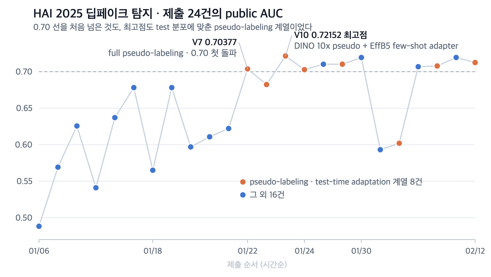

이 프로젝트는 DACON `HAI 2025 Deepfake Detection Challenge` 기록이다. 생성형 AI로 만들어진 딥페이크 영상과 실제 영상을 구분하는 문제였고, 최종 제출은 image/frame 단위의 real/fake 판별 모델을 중심으로 운영했다.

> **먼저 밝혀 둔다.** 리더보드 기록은 private AUC `0.70403`(`1,356`팀 중 `121`위)이지만, 이 점수는 대회 규정이 금지한 두 방법 — Test Set을 학습에 쓰는 pseudo-labeling과 여러 모델 결과를 평균하는 앙상블 — 으로 얻은 것이다. 규정을 `docs/constraints.md`에 정리해 두고도 실험을 바꿀 때마다 그 기준에 비춰 보지 않았다. 그래서 이 순위는 성과로 쓰지 않는다. 규정 안에서 확인된 단일 모델의 대회 테스트 AUC는 약 `0.49~0.64`였다.

이 글은 그 과정을 숨기지 않고 남기는 기록이다.

## 문제와 접근

공식 학습 데이터가 충분히 주어지는 전형적인 이미지 분류 문제가 아니었다. 참가자가 외부 데이터를 직접 모으고, 얼굴 검출과 crop, frame sampling, 모델 학습, 제출 형식 검증까지 묶어야 했다. 이 때문에 모델 구조보다 데이터 구성과 도메인 갭이 훨씬 크게 작동했다.

초기 접근은 서로 다른 inductive bias를 가진 모델을 섞는 것이었다.

| 모델              | 역할                                            |
| ----------------- | ----------------------------------------------- |
| `DINOv2 Large`    | 전역적 얼굴/영상 artifact와 고수준 패턴 포착    |
| `EfficientNet-B5` | 국소 텍스처, 압축 흔적, 작은 artifact 탐지      |
| `ViT Base`        | ensemble diversity와 mode collapse 완충         |
| `ConvNeXt`        | blur, compression 등 품질 저하 상황에 대한 보강 |

제출 이력은 꽤 선명했다. single DINO는 약했고, DINO/ViT/EfficientNet baseline ensemble은 public `0.6781`까지 올라갔다. 이후 pseudo-labeling 계열 실험에서 public `0.7038`, 최종적으로 V10 ensemble에서 public `0.7215`를 찍었다. 반면 ConvNeXt Celeb-DF injection이나 recursive pseudo-labeling은 기대만큼 안정적이지 않았다.

## 가장 큰 상승이 곧 규정 위반이었다

가장 크게 오른 실험은 test distribution에 강하게 맞춘 pseudo-labeling이었다. V10은 DINO pseudo 10x, EffB5 few-shot adapter, ViT regularizer를 `0.5 / 0.4 / 0.1`로 섞은 형태였고, 제출 기록상 public best였다.

하지만 이 실험은 "좋은 방법"이 아니라 규정 위반이다. 대회 규정을 정리한 `docs/constraints.md`는 Test Set을 학습이나 fine-tuning에 쓰는 것을 leakage로 **금지**하고, 여러 모델의 예측을 평균·가중합하는 결과 앙상블도 **금지**한다. V10은 두 가지를 모두 했다. 문서는 대회 초반에 이미 써 두었는데, 점수가 오를 때마다 그 문서에 비춰 보지 않았다. 이 회고의 핵심은 "규정과 리더보드가 충돌할 수 있다"가 아니라, **규정을 알고도 실험 설계의 첫 조건으로 두지 않았다**는 내 실수다.

실전 대회에서는 다음을 분리해서 기록해야 한다.

1. 점수 탐색용 실험인지, 최종 제출 가능한 compliant 후보인지 구분한다.
2. test set adaptation이 규정상 허용되는지 먼저 확인한다.
3. public score가 좋아져도 private/reproducibility audit에서 살아남을지 별도 판단한다.
4. submission history에 local/public/private와 risk memo를 함께 남긴다.

이 구분이 없으면 public AUC `0.7215`라는 숫자가 오히려 위험한 착시가 된다.

## 실패에서 배운 것

이 대회에서는 성능보다 운영에서 배운 게 많았다.

- `ConvNeXt` 결과가 all-zero로 나온 제출이 있었고, 제출 파일 검증의 중요성을 다시 확인했다.
- recursive pseudo-labeling은 점수를 떨어뜨렸다. pseudo signal이 강해질수록 domain adaptation이 아니라 자기 확신의 증폭이 될 수 있었다.
- video model `CNN+LSTM`은 규정의 시계열 학습 금지에 걸리는 방법이었고, 앙상블에 섞은 제출도 점수가 내려갔다.
- 외부 데이터 Celeb-DF는 직관과 달리 안정적인 개선으로 이어지지 않았다. deepfake 탐지는 "외부 데이터가 많으면 좋다"보다 "평가 분포와 맞는 artifact를 학습했는가"가 더 중요했다.

## 포트폴리오에 남길 이유

이 프로젝트의 순위는 내세울 수 없다. 남길 만한 것은 실패를 숨기지 않는 운영 기록이다. `docs/SUBMISSION_HISTORY.csv`에는 제출 ID, 파일명, public score, 모델 구성, 실패 메모가 한 줄씩 남아 있다. 이 기록 덕분에 나중에 봐도 "왜 V10은 좋았고, 왜 V13/V16은 기대보다 낮았는지"를 다시 추적할 수 있다.

딥페이크 탐지 모델링 자체도 중요했지만, 이 대회가 남긴 가장 큰 문장은 이것이다.

> public leaderboard는 실험 계기일 수 있지만, 최종 판단 기준은 규정, 재현성, private robustness까지 포함해야 한다.

대회가 끝난 뒤 이 문장을 블로그에 남겨두는 이유는 간단하다. 다음 대회에서 같은 유혹이 오기 때문이다. 점수가 오르면 좋아 보인다. 하지만 좋은 기록은 점수뿐 아니라, 그 점수가 어떤 조건에서 만들어졌는지까지 설명할 수 있어야 한다.

## 기록 포인트

제출 ID별 public score와 모델 구성은 [제출 이력 전체](https://github.com/softkleenex/kaggle-hai-2025/blob/HEAD/docs/SUBMISSION_HISTORY.csv)에 한 줄씩 남겼다.

대회 규정을 정리한 문서는 [constraints.md](https://github.com/softkleenex/kaggle-hai-2025/blob/HEAD/docs/constraints.md)에 있다. public score가 오를 때마다 이 문서를 다시 봐야 했는데, 그러지 않았다. 지금은 실험을 시작하기 전에 규정 체크리스트부터 통과시킨다.
